<div align="center">

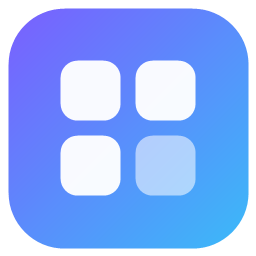

# PadDeck

**Turn your Android tablet or phone into a wireless Stream Deck for your Windows PC.**

Tap big, colourful buttons on your tablet to mute your microphone, change the volume, control music, open apps, take screenshots, play sound effects and more — and design every button from a simple editor on your PC.

[Download](../../releases) · [User Guide](docs/USER_GUIDE.md) · [Installation](docs/INSTALLATION.md) · [Connecting your tablet](docs/CONNECTION_GUIDE.md) · [Troubleshooting](docs/TROUBLESHOOTING.md) · [FAQ](docs/FAQ.md) · [Video tutorials](#video-tutorials) · [▶️ YouTube](https://youtu.be/_cetggr3Q60)

### ▶️ Watch the full tutorial on YouTube

<a href="https://youtu.be/_cetggr3Q60">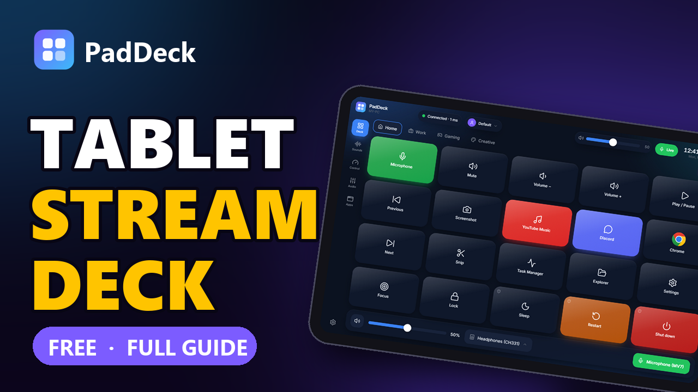</a>

*Click the image to watch: install, pair, customize and use PadDeck in 11 minutes.*

</div>

---

## Contents
1. [What is PadDeck?](#1-what-is-paddeck)
2. [Features](#2-features)
3. [Screenshots](#3-screenshots)
4. [Requirements](#4-requirements)
5. [Installation](#5-installation)
6. [Connecting your tablet](#6-connecting-your-tablet)
7. [How to use PadDeck](#7-how-to-use-paddeck)
8. [Troubleshooting](#8-troubleshooting)
9. [FAQ](#9-faq)
10. [Privacy and security](#10-privacy-and-security)
11. [Development](#11-development)
12. [License and credits](#12-license-and-credits)

---

## 1. What is PadDeck?

A **Stream Deck** is a small keypad covered in buttons that streamers and creators use to control their computer with one press — "mute mic", "open Discord", "play a sound". Dedicated hardware costs money and has a fixed number of keys.

**PadDeck does the same job with a device you already own.** You install two apps:

| App | Runs on | What it does |
|---|---|---|
| **PadDeck Desktop** | Your Windows PC | Carries out the button presses, and lets you design your buttons in the **Stream Deck Editor**. It runs quietly in the system tray. |
| **PadDeck for Android** | Your tablet or phone | Shows the buttons. Tap one and the PC does it instantly. |

**How it works:** both devices must be on the **same Wi-Fi network**. You pair them once by scanning a QR code. After that, every tap on the tablet is sent to your PC over your home network — no internet, no account and no cloud service involved. Any change you make in the editor appears on the tablet straight away.

**Who is it for?** Streamers, gamers, people on lots of video calls, creators who want quick shortcuts, and anyone who wants a handy remote for their PC.

**Why it's useful**
- Large touch buttons are faster than hunting for keyboard shortcuts.
- One tap to mute your microphone during a call, at the Windows level (works in every app).
- Your own pages for Home, Work, Gaming and Creative, plus folders.
- A soundboard that plays through your **PC speakers**, not the tablet.
- Live PC stats (CPU, GPU, memory, batteries) at a glance.

---

## 2. Features

Everything below is implemented in PadDeck 2.1. Limitations are stated where they exist.

### Stream Deck controls (the default Home page)
| Button | What happens on the PC |
|---|---|
| **Microphone** | Mutes/unmutes your default Windows microphone. The tile turns **red** and says *Mic muted* when muted, **green** when live. |
| **Mute** | Mutes/unmutes the PC speakers or headphones. |
| **Volume − / Volume +** | Lowers/raises the master volume by 5%. |
| **Play / Pause, Previous, Next** | Controls whatever is playing (YouTube Music in Chrome/Edge, Spotify, media players). |
| **Screenshot** | Saves a picture of all your screens to `Pictures\Screenshots` (named `PadDeck_<date>.png`) and copies it to the clipboard. |
| **Snip** | Opens the Windows snipping tool (Win + Shift + S) so you can select an area. |
| **YouTube Music, Discord, Chrome** | Opens the app (YouTube Music opens in your browser if the app isn't installed). |
| **Task Manager, Explorer, Settings** | Opens those Windows tools. |
| **Focus** | Turns on Focus mode: volume drops to 25%, Windows notifications are switched off and the soundboard is muted. Tap again to restore. |
| **Lock** | Locks Windows (like pressing Win + L). |
| **Sleep, Restart, Shut down** | Power actions. **PadDeck always asks you to confirm** these. Restart and Shut down start after a 5-second delay. |

The bar at the bottom of the tablet gives you a **volume slider**, the **current speaker/headphones** (tap to switch) and a big **microphone** button.

### Customisation
- **Add apps in one click** — PadDeck scans your PC and finds installed apps automatically (Start menu, installed programs, desktop shortcuts, program folders and Microsoft Store apps), with their real icons.
- **Files and folders** — add a tile that opens a project folder, a PDF, a video, a script or any file. If the file is later moved or deleted, the tile shows **Unavailable**.
- **Rearrange** — drag and drop tiles on the PC editor or on the tablet; move tiles to other pages or into **folders**.
- **Remove, duplicate, undo** — delete tiles, copy them, and undo any change.
- **Button designer** — title, icon, emoji, your own image or the app's icon, background colour or gradient, text colour, icon position, font size, corner radius, size (1×1 up to 3×3) and toggle (on/off) looks.
- **Pages, folders and profiles** — Home, Work, Gaming, Creative and your own pages; grids from 3×2 up to 8×4; profiles such as Default, Work, Gaming, Productivity, Creative and Music, each with its own pages, soundboard and theme.
- **Themes** — Dark, Light, Midnight, AMOLED, Minimal or your own colours (with a colour picker and HEX codes such as `#01B6BE`).
- **Phones too** — portrait and landscape layouts that adapt when you rotate the device.

### Soundboard
Upload **MP3, WAV, OGG, M4A or FLAC** sounds, organise them into categories (Funny Sounds, Memes, Reactions, Notifications, Gaming, Custom Sounds) and pages, give each a name, icon or emoji, colour and volume. Tap to play — tap again to layer sounds — and use **Stop all** at any time. Sounds play through your **PC's current output** (switchable from the Soundboard page).

### Control Centre
Live readings from your PC: **CPU** usage, **GPU** usage and temperature (NVIDIA), **memory**, **disk space**, **network** speed, **uptime**, **mouse/keyboard battery** (Bluetooth devices), other wireless device batteries, the **YouTube Music** player (title, artwork, progress, seek, play/pause/next/previous), quick **audio** sliders, **Discord & voice** buttons and shortcuts. If Windows can't provide a value, PadDeck shows **Unavailable** rather than guessing.

### Audio Control
One-tap switching of speakers/headphones and microphones, master and microphone volume, per-app volume and mute (e.g. turn Chrome down while gaming), and audio profiles (Gaming, Work, Meeting, Music, Silent).

---

## 3. Screenshots

> Screenshots were taken from the real app using demo mode, which replaces the PC name and network address with examples.

| | |
|---|---|
| **Stream Deck Editor (PC)**<br>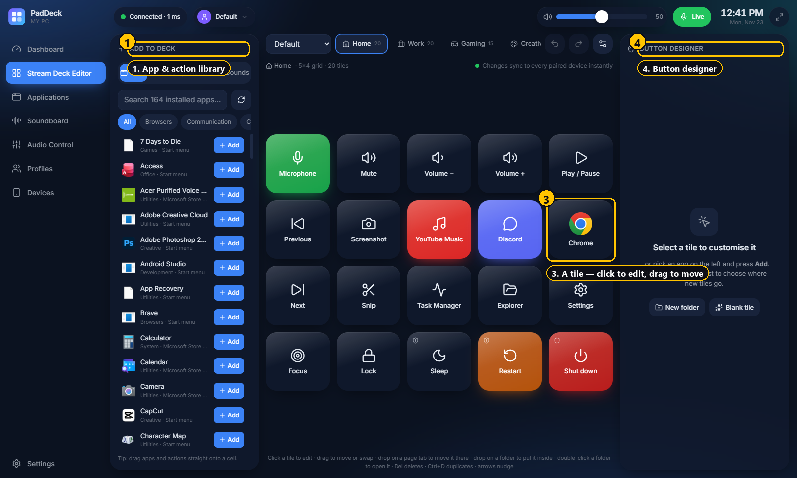 | **Button designer (PC)**<br>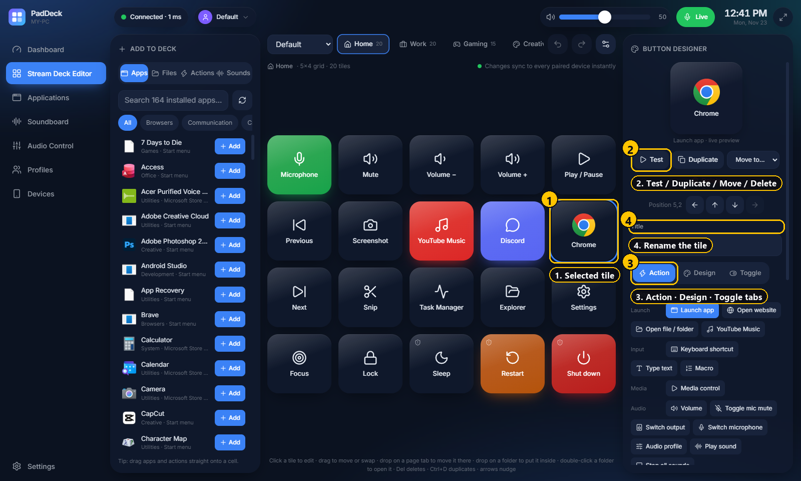 |
| **Application library (PC)**<br>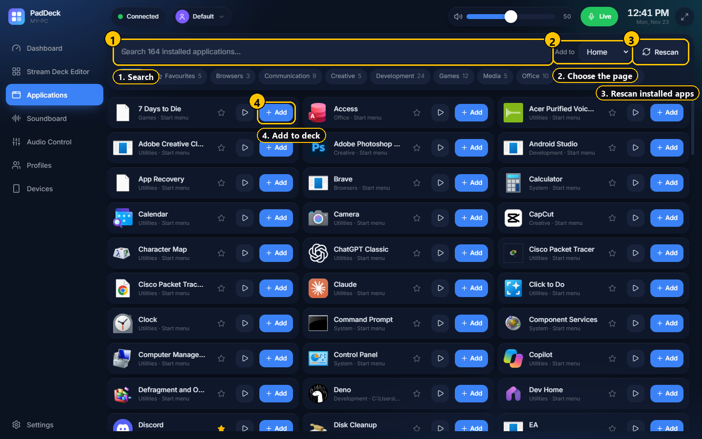 | **Pairing a device (PC)**<br>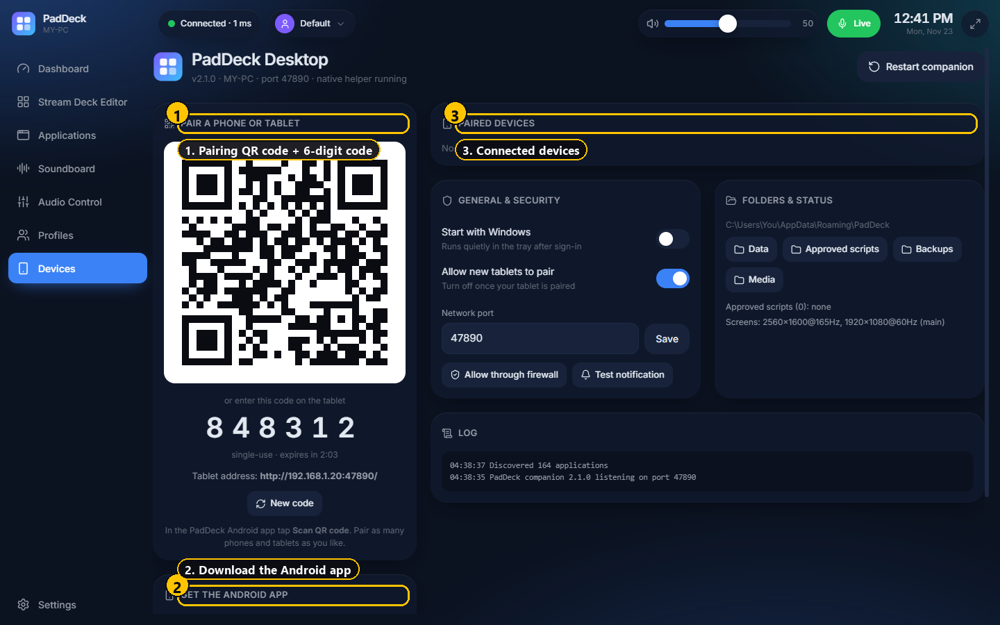 |
| **Tablet – Home page**<br>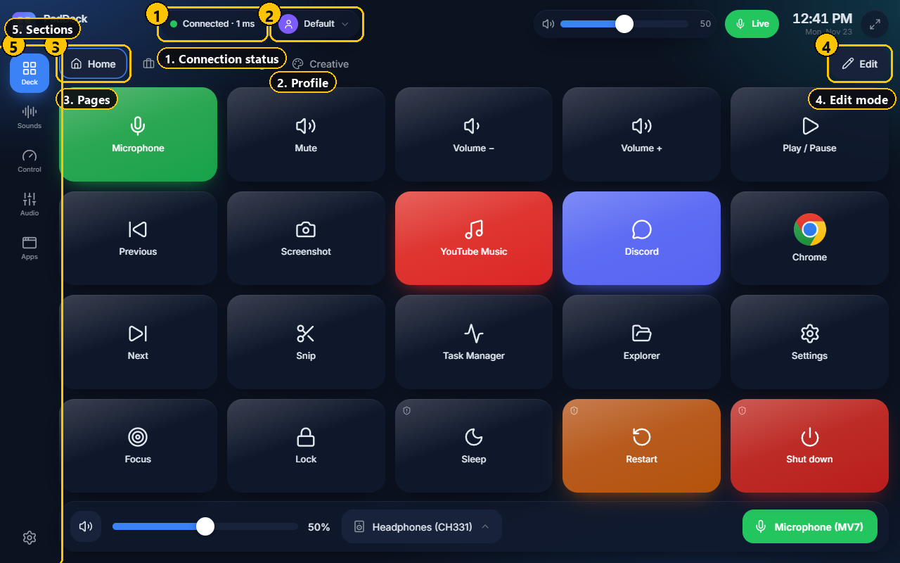 | **Tablet – Edit mode**<br>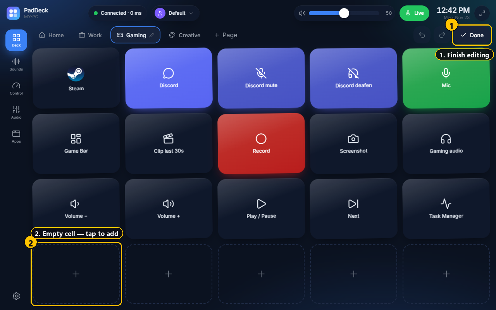 |
| **Tablet – Soundboard**<br>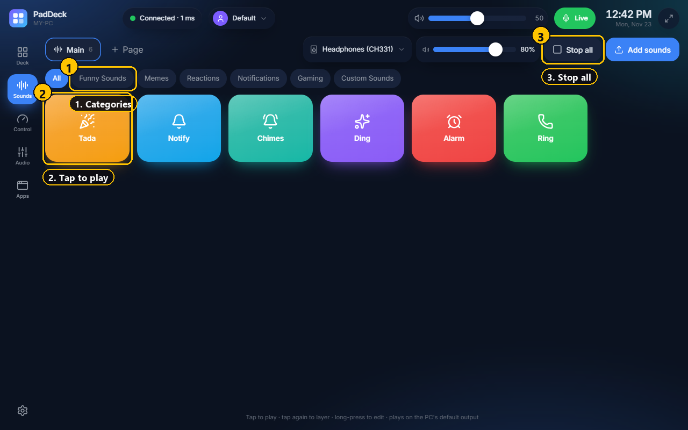 | **Tablet – Control Centre**<br>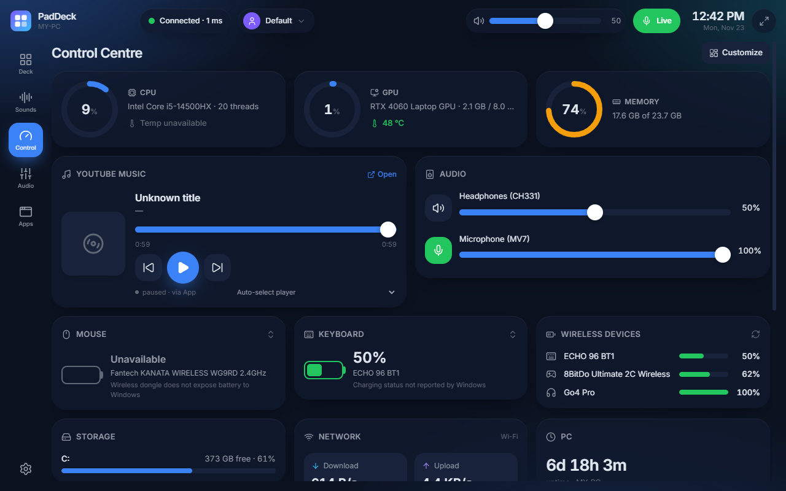 |
| **Phone – portrait**<br>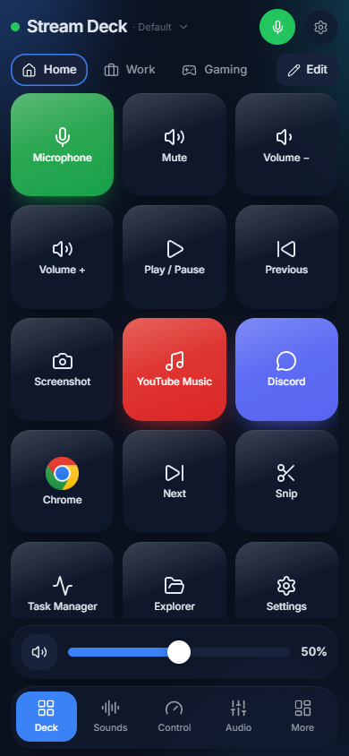 | **Phone – landscape**<br>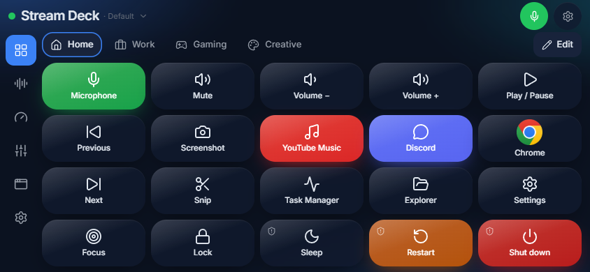 |

### Video tutorials

**Watch the complete tutorial on YouTube: https://youtu.be/_cetggr3Q60**

The same narrated walkthroughs, with subtitles (MP4 + `.srt`), are also in [`docs/videos/`](docs/videos). The script with timestamps is in [`docs/VIDEO_SCRIPT.md`](docs/VIDEO_SCRIPT.md).

| # | Video | Length |
|---|---|---|
| 1 | [Introduction](docs/videos/01-introduction.mp4) | 0:58 |
| 2 | [Installation and setup](docs/videos/02-installation-guide.mp4) | 1:09 |
| 3 | [Connecting your tablet](docs/videos/03-connection-guide.mp4) | 1:40 |
| 4 | [Understanding the interface](docs/videos/04-interface-tour.mp4) | 1:04 |
| 5 | [Customizing your Stream Deck](docs/videos/05-customization-guide.mp4) | 1:28 |
| 6 | [Using the Stream Deck controls](docs/videos/06-stream-deck-controls.mp4) | 1:23 |
| 7 | [Using the soundboard](docs/videos/07-soundboard.mp4) | 0:50 |
| 8 | [The Control Centre](docs/videos/08-control-centre.mp4) | 0:53 |
| 9 | [Troubleshooting](docs/videos/09-troubleshooting.mp4) | 0:59 |
| 10 | [Final tips](docs/videos/10-final-tips.mp4) | 0:42 |
| | [All ten in one video](docs/videos/complete-tutorial.mp4) | 11:06 |


---

## 4. Requirements

| | Requirement |
|---|---|
| **PC** | Windows 10 or Windows 11, 64-bit. About 300 MB of free space. |
| **Tablet or phone** | Android 8.0 (Oreo) or newer. Tested layout on a Xiaomi Pad 5 (2560×1600) and phone-sized screens. |
| **Network** | PC and tablet on the **same Wi-Fi / home network**. Guest networks and some public/office networks block devices from talking to each other. No internet connection is needed once installed. |
| **Optional** | NVIDIA graphics driver (for GPU temperature), LibreHardwareMonitor (for CPU temperature), Bluetooth mouse/keyboard (for battery readings). |
| **To build from source only** | Node.js 20.19 or newer, Git. Android builds also need JDK 17 and the Android SDK (the build script downloads them). |

---

## 5. Installation

Full illustrated steps: **[docs/INSTALLATION.md](docs/INSTALLATION.md)**.

**Short version**
1. Open the **[Releases](../../releases)** page and download `PadDeck-Setup-2.1.0.exe` and `PadDeck.apk`.
2. **On the PC:** double-click `PadDeck-Setup-2.1.0.exe`. If Windows shows *"Windows protected your PC"*, click **More info → Run anyway** (the installer isn't code-signed). Click **Next / Install**. PadDeck starts and a blue PadDeck icon appears in the system tray (bottom-right of the taskbar).
3. If Windows Firewall asks whether to allow PadDeck, tick **Private networks** and click **Allow**.
4. **On the tablet:** the easiest way is to open PadDeck on the PC → **Devices** → scan the **Get the Android app** QR code with the tablet's camera. Open the downloaded file and allow *Install unknown apps* when Android asks. (You can also copy `PadDeck.apk` to the tablet with a USB cable.)

---

## 6. Connecting your tablet

Full guide with pictures: **[docs/CONNECTION_GUIDE.md](docs/CONNECTION_GUIDE.md)**.

1. **Same network** — make sure the PC and tablet use the same Wi-Fi.
2. **On the PC** — open PadDeck (click the tray icon) and choose **Devices** in the left sidebar. You'll see a **QR code**, a **6-digit code** and the PC's address (for example `http://192.168.1.20:47800/`).
3. **On the tablet** — open the PadDeck app. Tap **Scan QR code** and point the camera at the QR code on your PC screen. *(Alternatively pick your PC from the list of PCs found on the network, and type the 6-digit code.)*
4. **Done** — the tablet shows your buttons, and the PC lists your tablet under **Paired devices** with a green dot.


**What the connection badge (top of the screen) means**

| Badge | Meaning | What to do |
|---|---|---|
| 🟢 **Connected · 12 ms** | Working. The number is how long a tap takes to reach the PC (lower is better). | Nothing. |
| 🟡 **Connected** (amber dot) | Working but slow (over 250 ms). | Move closer to the router; avoid busy Wi-Fi. |
| 🟡 **Connecting…** | Trying to reach the PC. | Wait a few seconds. Check PadDeck is running on the PC. |
| 🔴 **Disconnected** | The PC can't be reached; PadDeck keeps retrying automatically. | See [Troubleshooting](#8-troubleshooting). |

On phones the badge is a small coloured dot next to the page title. Pairing codes work **once** and expire after **5 minutes** — press **New code** if one has expired.

---

## 7. How to use PadDeck

The **[User Guide](docs/USER_GUIDE.md)** explains every feature step by step. The essentials:

### On the tablet


1. **Connection status** · 2. **Profile** (tap to switch) · 3. **Pages** — Home, Work, Gaming, Creative · 4. **Edit** — rearrange and change tiles · 5. **Sections** — Stream Deck, Soundboard, Control Centre, Audio, Apps, Settings.

- **Run an action:** tap a tile. A short message at the bottom confirms what happened (e.g. *"Task Manager opened"*).
- **Change a tile:** tap **Edit**, then tap the tile. Or **long-press** any tile for *Edit / Move earlier / Duplicate / Move to page / Run now / Delete*.
- **Add a tile:** tap **Edit**, tap an empty dashed square, choose an app, file, action or sound.
- **Move a tile:** in Edit mode, drag it onto another square (drop it on a folder to put it inside).

### On the PC – Stream Deck Editor


1. **Library** — search your installed apps and press **Add**, or drag them onto a square. Tabs for **Files**, **Actions** (Windows controls, shortcuts, media, audio, Discord, navigation) and **Sounds**.
2. **Pages** — click to switch; drop a tile on a page name to move it there.
3. **Tiles** — click to edit, drag to move or swap. Keyboard: **Delete** removes, **Ctrl+D** duplicates, **arrow keys** nudge, **Ctrl+Z / Ctrl+Y** undo/redo.
4. **Button designer** — change the action, look and toggle behaviour with a live preview.

Every change is saved automatically and appears on all your devices immediately.

### Soundboard
Open **Soundboard** → **Add sounds** to upload files → tap a sound to play → **Stop all** to silence everything. Long-press a sound to rename it, change its icon, colour, category or volume.

### Control Centre
Open **Control Centre** (tablet) or **Dashboard** (PC). Tap **Customize** to show, hide or reorder the widgets.

---

## 8. Troubleshooting

More fixes: **[docs/TROUBLESHOOTING.md](docs/TROUBLESHOOTING.md)**.

| Problem | Try this |
|---|---|
| **Tablet can't find or connect to the PC** | 1. Check both are on the same Wi-Fi (not a guest network). 2. Make sure PadDeck is running (tray icon). 3. Allow PadDeck through Windows Firewall: PadDeck → Devices → **Allow through firewall**. 4. Type the address shown under the QR code into the app manually. |
| **Pairing code rejected** | Codes work once and expire after 5 minutes. Press **New code** on the PC. After 8 wrong tries, wait one minute. |
| **Keeps disconnecting** | Keep the tablet's Wi-Fi on while the screen is off; move closer to the router; give your PC a reserved IP address in your router settings. |
| **A button does nothing** | Look at the message at the bottom of the tablet. Apps running as administrator ignore shortcuts from normal apps — run PadDeck as administrator only if you need that. |
| **An app won't launch / tile says Unavailable** | The app or file was moved or uninstalled. Edit the tile and pick it again (Applications → **Rescan**). |
| **Microphone button doesn't mute** | It controls your **default** Windows microphone. Check which one is default in PadDeck's Audio page and switch if needed. |
| **Media buttons do nothing** | Something must be playing in an app that supports Windows media controls (browser, Spotify, media players). |
| **Soundboard is silent** | Sounds play on the PC's current output — check the speaker shown at the top of the Soundboard and the PC volume. Focus mode mutes the soundboard. |
| **PadDeck won't start** | Another program may be using port 47800. Change the port in Devices → General & security, or restart the PC. |

---

## 9. FAQ

<details><summary><b>Do I need an internet connection or an account?</b></summary>No. PadDeck works entirely on your home network. No account, no subscription, no cloud.</details>
<details><summary><b>Can I use my phone and my tablet at the same time?</b></summary>Yes. Pair as many devices as you like; changes sync to all of them.</details>
<details><summary><b>Can I use PadDeck away from home?</b></summary>Not directly — both devices must be on the same network. Advanced users can use a private VPN such as Tailscale.</details>
<details><summary><b>Does it work on iPad or iPhone?</b></summary>There is no iOS app. iPads/iPhones can open PadDeck in a browser (type the PC address shown in Devices), but QR scanning and automatic discovery need the Android app.</details>
<details><summary><b>Will a button really shut down my PC?</b></summary>Only after you confirm, and only after a 5-second delay.</details>
<details><summary><b>Why does Windows warn me when I install it?</b></summary>The installer isn't code-signed (signing certificates cost money). Click More info → Run anyway.</details>

More questions: **[docs/FAQ.md](docs/FAQ.md)**.

---

## 10. Privacy and security

- **Stays on your network.** The PC and tablet talk directly over your local network (HTTP and WebSocket on port **47800**, plus UDP port **47801** for finding the PC). Nothing is sent to the internet, with two optional exceptions you start yourself: opening websites from a tile, and the link that opens YouTube Music.
- **Pairing.** A device can only control your PC after you pair it with a **single-use 6-digit code that expires after 5 minutes**. Each device gets its own secret 256-bit key; the PC stores only a fingerprint (hash) of it. Too many wrong codes are blocked for a minute.
- **You stay in control.** See and remove paired devices in **Devices**; turn off *Allow new tablets to pair* once you're set up.
- **Limited actions.** Tiles can only perform PadDeck's built-in actions — there is no "run any command" button. Scripts run only if you copy them into `%APPDATA%\PadDeck\scripts` yourself. Shutdown, restart, sleep and sign-out always require confirmation.
- **Settings page is PC-only.** The pairing and settings pages only answer on the PC itself.
- **Your data.** Settings, uploaded sounds and images are stored on your PC in `%APPDATA%\PadDeck` and are never uploaded. Uninstalling PadDeck keeps this folder. Daily backups are kept in `%APPDATA%\PadDeck\backups`.
- **Note:** traffic on your home network is not encrypted (HTTP). Only use PadDeck on networks you trust.

---

## 11. Development

```
PadDeck/
├── companion/     Node.js server: pairing, sync, actions, app discovery (runs inside the desktop app)
├── dashboard/     React + TypeScript + Tailwind UI shared by the desktop editor and the Android app
├── desktop/       Electron app (tray, editor window, installer via electron-builder)
├── native/        PadDeckHelper.exe (C#): Windows audio, keyboard input, media, sounds, icons
├── android/       Kotlin app: WebView shell, QR scanner, network discovery
└── docs/          User guide, installation, connection, troubleshooting, FAQ, video script, images, videos
```

| Part | Technology |
|---|---|
| Desktop app | Electron 37, Node.js companion (ESM, bundled with esbuild), electron-builder (NSIS installer) |
| Interface | React 19, TypeScript, Vite 8, Tailwind CSS 4, Lucide icons |
| Windows integration | C# (.NET Framework 4.8, compiled with the `csc` that ships with Windows): Core Audio, SendInput, media sessions (SMTC), WPF media playback |
| Android | Kotlin, WebView + WebViewAssetLoader, ZXing QR scanner, UDP discovery |

**Build from source** (PowerShell, from the project folder):
```powershell
# 1. Native Windows helper
powershell -ExecutionPolicy Bypass -File native\build.ps1
# 2. Interface (used by both apps)
cd dashboard; npm install; npm run build; cd ..
# 3. Companion dependencies
cd companion; npm install; cd ..
# 4. Desktop app installer -> desktop\release\PadDeck-Setup-<version>.exe
cd desktop; npm install; npm run dist; cd ..
# 5. Android app -> PadDeck.apk (downloads JDK + Android SDK the first time)
powershell -ExecutionPolicy Bypass -File android\build-apk.ps1
```
Run in development: `cd desktop; npm start`. Companion options: `PADDECK_PORT`, `PADDECK_DATA` (data folder), `PADDECK_DEMO=1` (hides the PC name and address for screenshots).

The Android release signing key is **not** in this repository. Builds use it when `PADDECK_KEYSTORE` (or `%APPDATA%\PadDeck-signing\keystore.properties`) exists; otherwise they fall back to your local debug key — fine for personal builds, but they can't update an APK signed with the release key.

---

## 12. License and credits

PadDeck is released under the **MIT License** — see [LICENSE](LICENSE).

Built with [Electron](https://www.electronjs.org/), [React](https://react.dev/), [Vite](https://vite.dev/), [Tailwind CSS](https://tailwindcss.com/), [Lucide](https://lucide.dev/) icons, [Inter](https://rsms.me/inter/) font, [ws](https://github.com/websockets/ws), [qrcode](https://github.com/soldair/node-qrcode) and [ZXing Android Embedded](https://github.com/journeyapps/zxing-android-embedded). Tutorial narration voice generated with Microsoft Azure neural text-to-speech ("Ava").

*Maintainer: \<your name or GitHub username\>* · Not affiliated with Elgato or Corsair. "Stream Deck" is a trademark of Corsair Memory, Inc.
