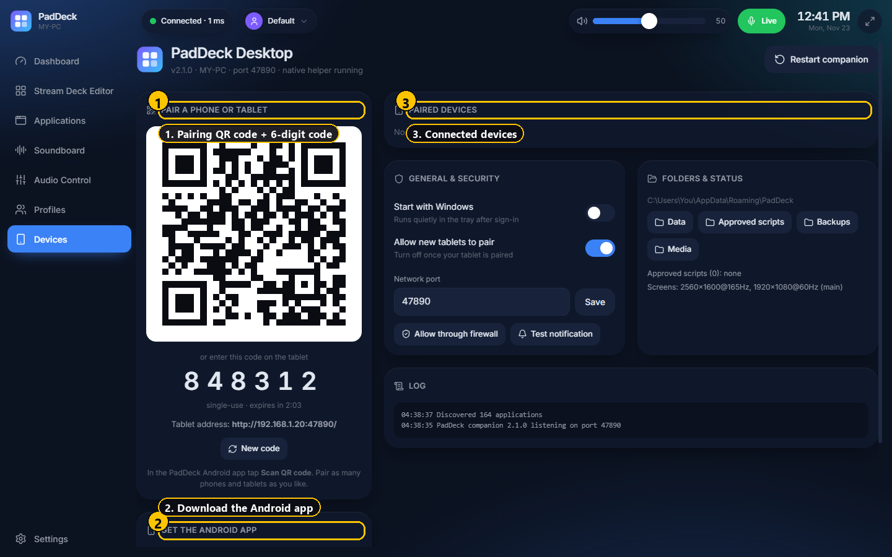
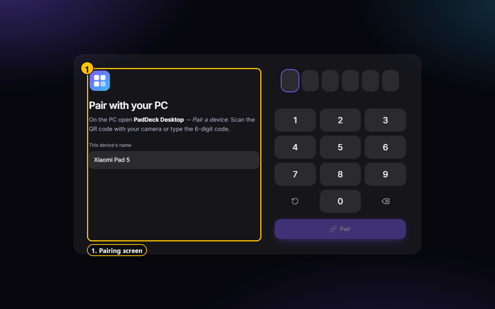

# Connecting your tablet or phone to your PC

Pairing connects your tablet to PadDeck Desktop. You do it **once per device** — after that the tablet reconnects by itself whenever both are on the same network.

[Back to README](../README.md) · Previous: [Installation](INSTALLATION.md) · Next: [User Guide](USER_GUIDE.md)

---

## How the connection works (in plain English)
- PadDeck Desktop runs a small server on your PC. Your tablet talks to it over your **home Wi-Fi** — it does not go through the internet.
- To make sure only **your** devices can control your PC, the PC shows a **pairing code** (as a QR code and as 6 digits). A code works **once** and expires after **5 minutes**.
- When pairing succeeds, the tablet receives its own secret key and remembers the PC. You won't need a code again unless you remove the device.

---

## Step 1 – Prepare the PC
1. Make sure **PadDeck Desktop** is running: look for the blue PadDeck icon in the system tray (bottom-right of the taskbar). Not there? Open **PadDeck** from the Start menu.
2. Click the tray icon to open the PadDeck window.

## Step 2 – Prepare the tablet
1. Install the **PadDeck** app ([Installation guide](INSTALLATION.md)).
2. Turn on **Wi-Fi**.

## Step 3 – Check you're on the same network
- On the **PC**: click the Wi-Fi icon in the taskbar — note the network name.
- On the **tablet**: Settings → Wi-Fi — it must show the **same** network name.
- Avoid networks named "Guest", and some office/school/hotel networks: they stop devices from seeing each other.

## Step 4 – Open the pairing page on the PC
In the PadDeck window, click **Devices** in the left sidebar (or right-click the tray icon → **Pair a phone or tablet…**).

You'll see:
1. **Pair a phone or tablet** – a large **QR code**, a **6-digit code** with a countdown (*expires in 4:32*), and the **Tablet address** (for example `http://192.168.1.20:47800/`).
2. **Get the Android app** – a QR code to download the app.
3. **Paired devices** – devices that are already paired (empty at first).

## Step 5 – Open PadDeck on the tablet
Tap the **PadDeck** icon. The first time, it shows **"Pair with your PC"**.

## Step 6 – Pair (choose one way)

### Way A – Scan the QR code (recommended)
1. Tap **Scan QR code**. Allow camera access if Android asks.
2. Point the camera at the big QR code on your PC screen.
3. PadDeck pairs automatically within a second.

### Way B – Pick your PC and type the code
1. Under **PCs found on this network**, tap your PC's name.
2. Type the **6 digits** shown on the PC using the on-screen keypad. Pairing starts as soon as you enter the sixth digit.

### Way C – Type the address (if your PC isn't found)
1. In **PC address**, type the **Tablet address** shown on the PC, e.g. `http://192.168.1.20:47800`.
2. Type the 6-digit code.

> **Using a browser instead of the app** (iPad, iPhone, other devices): open the browser, go to the **Tablet address**, and type the 6-digit code. Scanning the QR code with the camera also works — it opens the address and pairs automatically.

## Step 7 – Confirm it worked
- The tablet shows your **Stream Deck buttons**.
- The top bar shows a **green dot** and **Connected · 8 ms** (the number varies).
- On the PC, **Devices → Paired devices** lists your device with a **green dot** and **Connected**.
- Tap **Task Manager** on the tablet — Task Manager opens on the PC. 🎉

---

## Connection status explained

| What you see | Meaning | What to do |
|---|---|---|
| 🟢 **Connected · 12 ms** | Connected. The number is the time for a tap to reach the PC. Under ~50 ms feels instant. | Nothing. |
| 🟡 Amber dot with **Connected · 300 ms** and the message *"Connection quality degraded"* | Connected but slow (over 250 ms). | Move closer to the router, or use the 5 GHz Wi-Fi. |
| 🟡 **Connecting…** (pulsing) | Trying to reach the PC. | Wait a few seconds. |
| 🔴 **Disconnected** (pulsing) + *"PC connection lost – reconnecting…"* | The PC can't be reached. PadDeck retries automatically, faster when the tablet wakes up. | Check PadDeck is running on the PC and both devices are on the same Wi-Fi. |
| *"PC not reachable – retrying…"* on a full screen | Same as Disconnected, before any buttons have loaded. | As above. |
| Back on **"Pair with your PC"** + *"This device was unpaired from the PC"* | The device was removed in **Paired devices**. | Pair again with a new code. |
| *"Not connected to PC"* when tapping a button | The tap couldn't be sent. | Wait for **Connected**. |

On a **phone**, the status is the small coloured dot to the left of the page title.

---

## Managing devices
- **Pair more devices:** repeat the steps on each phone/tablet. Each gets its own entry.
- **Remove a device:** PC → Devices → Paired devices → **Remove**. That device is disconnected immediately and needs a new code to come back.
- **Stop new pairings:** switch off **Allow new tablets to pair** in *General & security* once all your devices are set up.
- **Unpair from the tablet:** tablet → Settings → **This device** → **Unpair this tablet**.
- **Disconnect temporarily:** just close the app or turn off Wi-Fi. When you come back, it reconnects by itself.

---

## If pairing or connecting fails

1. **"Wrong or expired pairing code"** – codes work once and last 5 minutes. On the PC click **New code** and try again.
2. **"Too many attempts. Wait a minute and try again."** – after 8 wrong codes in a minute, wait 60 seconds.
3. **"Pairing is disabled in the companion settings"** – on the PC switch on **Allow new tablets to pair**.
4. **No PC in the "found" list** –
   - Confirm both devices are on the same Wi-Fi.
   - On the PC click **Devices → Allow through firewall** and accept the Windows prompt.
   - In Windows **Settings → Network & internet → Wi-Fi → (your network)**, set the network profile to **Private**.
   - Type the address manually (Way C).
5. **Camera won't scan** – increase the PC screen brightness, hold the tablet 20–30 cm away, or use Way B.
6. **Worked yesterday, not today** – your router may have given the PC a new address. The app finds the PC again automatically; in a browser, type the new address shown in **Devices**. To stop the address changing, reserve an IP address for your PC in your router settings (search your router model + "DHCP reservation").
7. **Still stuck?** – see [Troubleshooting](TROUBLESHOOTING.md) or open the **Log** at the bottom of the Devices page.
