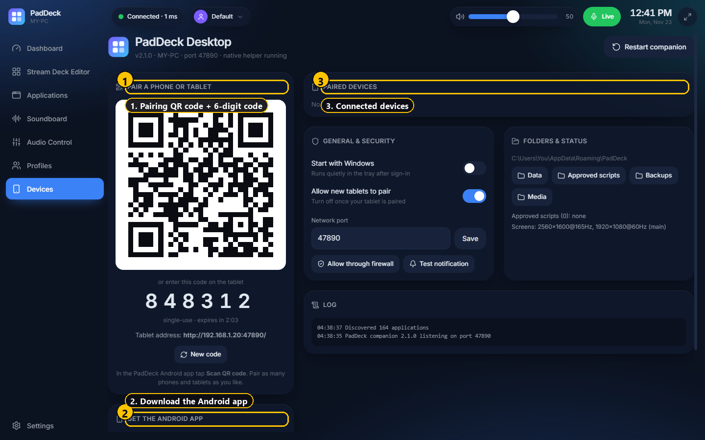

# Installing PadDeck

This guide assumes no technical knowledge. You will install **two** things:

1. **PadDeck Desktop** on your Windows PC (it does the work).
2. **PadDeck for Android** on your tablet or phone (it shows the buttons).

⏱️ About 10 minutes. [Back to README](../README.md) · Next: [Connecting your tablet](CONNECTION_GUIDE.md)

---

## Before you start

| You need | Notes |
|---|---|
| A Windows 10 or 11 PC (64-bit) | About 300 MB free space. |
| An Android tablet or phone, Android 8.0 or newer | Settings → About tablet shows your Android version. |
| Both devices on the **same Wi-Fi** | Not a "guest" network — those stop devices seeing each other. |

---

## Part 1 – Install PadDeck on your PC

**STEP 1 – Download the installer.**
Open the PadDeck **Releases** page on GitHub (link at the top of the README) and click **`PadDeck-Setup-2.1.0.exe`**. Your browser saves it to your **Downloads** folder.

**STEP 2 – Start the installer.**
Open your **Downloads** folder and double-click `PadDeck-Setup-2.1.0.exe`.

**STEP 3 – Get past the Windows warning (if it appears).**
Windows may show a blue box saying **"Windows protected your PC"**. This happens because the installer isn't digitally signed — it doesn't mean the file is harmful.
Click **More info**, then **Run anyway**.

**STEP 4 – Install.**
If the installer asks who to install for, choose **Only for me** (no administrator password needed). Keep the suggested folder, click **Install**, then **Finish** — PadDeck starts automatically.

**STEP 5 – Check it worked.**
- PadDeck opens a window with a sidebar (**Dashboard, Stream Deck Editor, Applications …**).
- A blue **PadDeck icon** appears in the system tray (bottom-right corner of the taskbar; click the **^** arrow if you can't see it).
- A **PadDeck** shortcut is on your desktop and in the Start menu.

**STEP 6 – Allow it through the firewall.**
If Windows asks *"Do you want to allow public and private networks to access this app?"*, tick **Private networks** and click **Allow**.
No prompt? Open PadDeck → **Devices** → **Allow through firewall** and click **Yes** in the Windows prompt.

> 💡 PadDeck starts automatically when you sign in to Windows. You can turn this off in **Devices → General & security → Start with Windows**, or from the tray icon menu.

**Closing PadDeck:** closing the window keeps PadDeck running in the tray (so your tablet keeps working). To quit completely, right-click the tray icon → **Quit PadDeck**.

---

## Part 2 – Install PadDeck on your tablet or phone

### Option A – Download straight from your PC (easiest)
1. On the PC, open PadDeck and click **Devices** in the sidebar.
2. Find the box **Get the Android app** with a small QR code.
3. On the tablet, open the **Camera** app and point it at that QR code. Tap the link that appears.
4. The browser downloads **PadDeck.apk**. Tap **Open** (or find it in **Files → Downloads**).
5. Android asks to allow installing apps from this source: tap **Settings**, switch on **Allow from this source**, go back and tap **Install**.
6. Tap **Open**. You'll see **"Pair with your PC"** — continue with the [Connection Guide](CONNECTION_GUIDE.md).

### Option B – Download from GitHub on the tablet
Open the Releases page in the tablet's browser, tap **PadDeck.apk**, then follow steps 4–6 above.

### Option C – Copy with a USB cable
Connect the tablet to the PC with a USB cable, choose **File transfer** on the tablet, copy `PadDeck.apk` to the tablet's **Download** folder, then open it with the **Files** app and follow steps 5–6.

> ℹ️ **Xiaomi / MIUI / HyperOS:** you may see an extra security screen — tap **Continue installation**. Some Xiaomi devices require you to be signed in to a Mi account to allow app installs.

> ⚠️ **Updating from an older PadDeck app?** If Android says *"App not installed as package conflicts with an existing package"*, uninstall the old PadDeck app first, then install again. Your buttons are stored on the PC, so nothing is lost — you just pair again.

---

## Updating PadDeck
Download the newer `PadDeck-Setup-x.y.z.exe` and run it — it installs over the old version. Your settings in `%APPDATA%\PadDeck` are kept (a backup is made automatically). Update the Android app the same way as installing it.

## Uninstalling
- **PC:** Windows **Settings → Apps → Installed apps → PadDeck → Uninstall**. Your settings folder `%APPDATA%\PadDeck` is kept; delete it yourself if you want everything gone.
- **Tablet:** long-press the PadDeck icon → **Uninstall**.

---

## For developers: building from source
You only need this if you want to change the code. Install **[Node.js](https://nodejs.org/) 20.19 or newer** and **[Git](https://git-scm.com/)**, then open **PowerShell** (Start menu → type *PowerShell*) and run these commands one at a time:

| Command | What it does |
|---|---|
| `git clone <repository-url> PadDeck` | Downloads the source code into a folder called PadDeck. |
| `cd PadDeck` | Moves into that folder. |
| `powershell -ExecutionPolicy Bypass -File native\build.ps1` | Builds the small Windows helper program (uses the C# compiler built into Windows). |
| `cd dashboard; npm install; npm run build; cd ..` | Downloads the interface's libraries and builds it. |
| `cd companion; npm install; cd ..` | Downloads the server's libraries. |
| `cd desktop; npm install; npm run dist; cd ..` | Builds the installer into `desktop\release\`. |
| `powershell -ExecutionPolicy Bypass -File android\build-apk.ps1` | Builds `PadDeck.apk`. The first run downloads Java and the Android SDK (~600 MB) and asks you to accept Google's Android SDK licence. |
