# PadDeck User Guide

Welcome! This guide teaches you PadDeck from the very beginning — no experience with Stream Decks or technical knowledge needed. Each section explains **why** you'd use a feature and walks you through it in small steps:

> **STEP 1** what to open · **STEP 2** where to click · **STEP 3** what to choose · **STEP 4** what should happen · **STEP 5** how to check it worked

[Back to README](../README.md) · [Installation](INSTALLATION.md) · [Connection Guide](CONNECTION_GUIDE.md) · [Troubleshooting](TROUBLESHOOTING.md) · [FAQ](FAQ.md)

## Contents
1. [Getting started](#1-getting-started)
2. [Installing PadDeck](#2-installing-paddeck)
3. [Opening PadDeck](#3-opening-paddeck)
4. [Understanding the interface](#4-understanding-the-interface)
5. [Connecting the tablet](#5-connecting-the-tablet)
6. [Understanding connection status](#6-understanding-connection-status)
7. [Navigating pages](#7-navigating-pages)
8. [Adding applications](#8-adding-applications)
9. [Removing applications](#9-removing-applications)
10. [Rearranging tiles](#10-rearranging-tiles)
11. [Customizing buttons](#11-customizing-buttons)
12. [Creating and managing profiles](#12-creating-and-managing-profiles)
13. [Using microphone controls](#13-using-microphone-controls)
14. [Using volume controls](#14-using-volume-controls)
15. [Using media controls](#15-using-media-controls)
16. [Taking screenshots](#16-taking-screenshots)
17. [Launching applications](#17-launching-applications)
18. [Using Windows shortcuts](#18-using-windows-shortcuts)
19. [Using power controls](#19-using-power-controls)
20. [Using the soundboard](#20-using-the-soundboard)
21. [Using the Control Centre](#21-using-the-control-centre)
22. [Disconnecting and reconnecting](#22-disconnecting-and-reconnecting)
23. [Troubleshooting](#23-troubleshooting)

**Words used in this guide**
| Word | Meaning |
|---|---|
| **Tile** / **button** | One square on your Stream Deck. Tapping it does something on your PC. |
| **Page** | A screen full of tiles (Home, Work, Gaming, Creative…). |
| **Folder** | A tile that opens a smaller page of more tiles. |
| **Profile** | A complete set of pages, sounds and colours (e.g. "Work" or "Gaming"). |
| **Pairing** | Introducing your tablet to your PC once, so they trust each other. |
| **System tray** | The small icons at the bottom-right of the Windows taskbar. |
| **Long-press** | Touch and hold a tile for about half a second. |

---

## 1. Getting started
**Purpose:** know what PadDeck is and what you need.

PadDeck has two parts that work together:
- **PadDeck Desktop** on your Windows PC – it carries out every action and contains the **Stream Deck Editor** where you design your buttons.
- **PadDeck for Android** on your tablet or phone – it shows the buttons. Tap one, and the PC does it.

**Prerequisites:** a Windows 10/11 PC, an Android 8.0+ tablet or phone, and one Wi-Fi network that both use.

**Expected result:** after setup, tapping **Task Manager** on your tablet opens Task Manager on your PC.

**Common mistakes:** using a guest or office network that blocks devices from talking to each other.

---

## 2. Installing PadDeck
**Purpose:** put PadDeck on both devices. Full details with pictures: [INSTALLATION.md](INSTALLATION.md).

**STEP 1 – What to open:** the PadDeck **Releases** page on GitHub.
**STEP 2 – Where to click:** download `PadDeck-Setup-2.1.0.exe` and double-click it in your Downloads folder.
**STEP 3 – What to select:** if Windows warns *"Windows protected your PC"*, click **More info → Run anyway**; then **Install**.
**STEP 4 – What should happen:** PadDeck opens and its blue icon appears in the system tray.
**STEP 5 – How to confirm:** the PadDeck window shows a sidebar starting with **Dashboard** and **Stream Deck Editor**.

Then install the app on your tablet: PadDeck → **Devices** → scan **Get the Android app** with the tablet camera → open **PadDeck.apk** → **Install**.

**Common mistakes:** clicking *Don't run* at the Windows warning; blocking the firewall prompt (choose **Allow** for Private networks).

---

## 3. Opening PadDeck
**Purpose:** start PadDeck on each device.

**On the PC**
**STEP 1:** look at the bottom-right of the taskbar (click **^** to see hidden icons).
**STEP 2:** click the blue **PadDeck** icon. (Or open **PadDeck** from the Start menu or desktop shortcut.)
**STEP 3:** the PadDeck window opens on the **Stream Deck Editor**.
**STEP 4:** closing the window with **X** keeps PadDeck running in the tray, so your tablet keeps working.
**STEP 5:** to quit completely, right-click the tray icon → **Quit PadDeck**.

**On the tablet:** tap the **PadDeck** app icon. It opens full screen and connects to your PC automatically once paired.

**Tip:** PadDeck starts with Windows by default, so you rarely need to open it yourself.

---

## 4. Understanding the interface

### The tablet
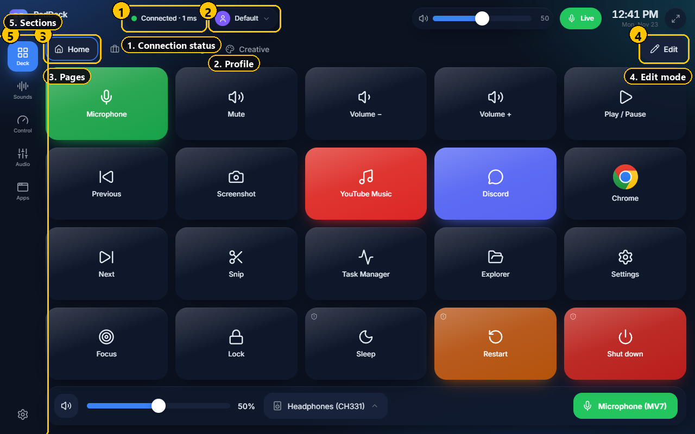

| # | Part | What it does |
|---|---|---|
| 1 | **Connection status** | Green dot + *Connected · 12 ms* when everything works. See [section 6](#6-understanding-connection-status). |
| 2 | **Profile** (*Default*) | Tap to switch to another profile, e.g. Work or Gaming. |
| 3 | **Pages** | Home, Work, Gaming, Creative – tap to switch pages. |
| 4 | **Edit** | Turns on editing so you can add, move, change and delete tiles. |
| 5 | **Sections** (left) | **Deck** (Stream Deck), **Sounds** (Soundboard), **Control** (Control Centre), **Audio**, **Apps**, and **⚙ Settings** at the bottom. |
| – | **Volume slider** (bottom) | Drag to change the PC volume; the speaker button mutes. |
| – | **Headphones (…)** (bottom) | Shows the current output device – tap to switch. |
| – | **Microphone (…)** (bottom right) and **Live** (top) | Green = microphone on; red = muted. Tap to mute/unmute. "Live" is a status, not a separate mode. |
| – | **⤢** (top right) | Full screen. |

**Phones:** the sections move to a bar at the bottom in portrait, and to a slim icon bar on the left in landscape. The layout changes when you rotate.

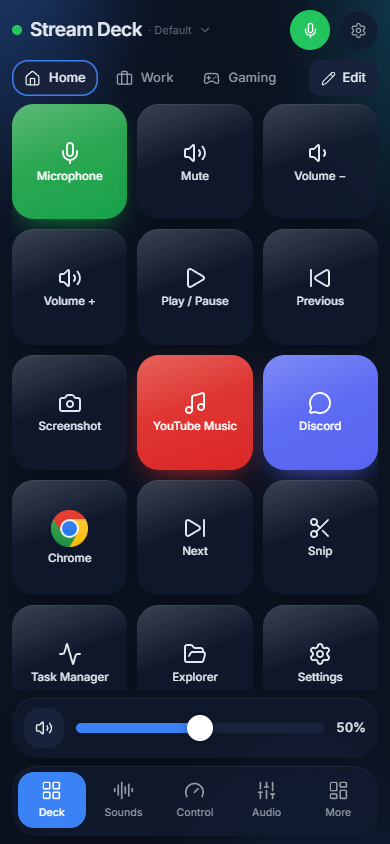 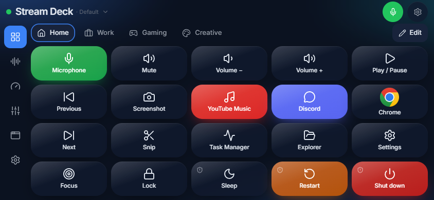

### The PC window
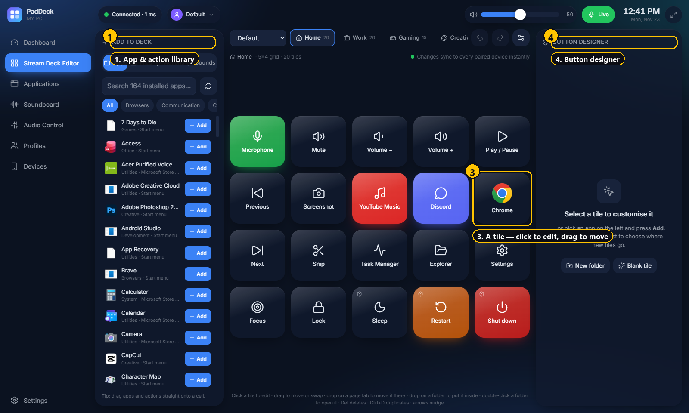

The left sidebar has: **Dashboard** (PC stats), **Stream Deck Editor**, **Applications**, **Soundboard**, **Audio Control**, **Profiles**, **Devices** (pairing) and **Settings**. In the editor: (1) the library to add things, (2) pages, (3) your tiles, (4) the button designer.

---

## 5. Connecting the tablet
**Purpose:** pair the tablet with your PC once. Full guide: [CONNECTION_GUIDE.md](CONNECTION_GUIDE.md).

**Prerequisites:** both apps installed; both devices on the same Wi-Fi.

**STEP 1 – What to open:** PadDeck on the PC → **Devices** (left sidebar).
**STEP 2 – Where to click:** nothing yet – note the **QR code** and **6-digit code** in *Pair a phone or tablet*.
**STEP 3 – What to select:** on the tablet open PadDeck → tap **Scan QR code** → point the camera at the QR code. *(Or tap your PC in "PCs found on this network" and type the 6 digits.)*
**STEP 4 – What should happen:** the tablet switches to your Stream Deck buttons.
**STEP 5 – How to confirm:** the tablet top bar shows **Connected**; the PC's **Paired devices** list shows your tablet with a green dot.

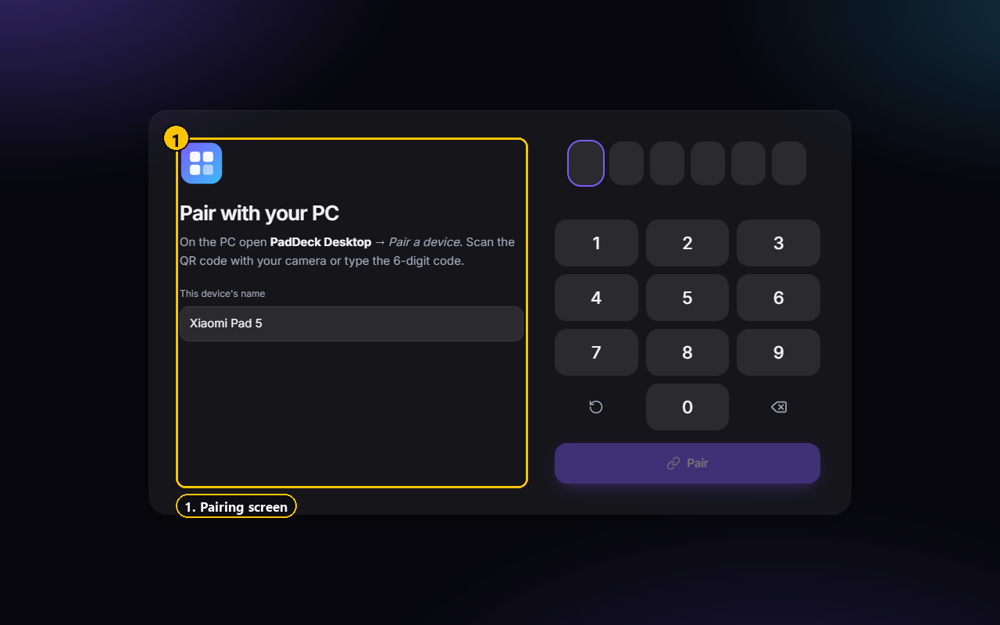

**Common mistakes:** using an expired code (they last 5 minutes and work once – click **New code**); PC and tablet on different networks.

---

## 6. Understanding connection status
**Purpose:** know at a glance whether PadDeck can reach your PC.

| Badge | Meaning |
|---|---|
| 🟢 **Connected · 12 ms** | Working. The number is how many milliseconds a tap takes to reach the PC. |
| 🟡 **Connected** with an amber dot | Working, but slow (over 250 ms). A message *Connection quality degraded* may appear. |
| 🟡 **Connecting…** | Trying to reach the PC – wait a few seconds. |
| 🔴 **Disconnected** | The PC can't be reached. PadDeck keeps retrying automatically. |

Messages you may see: *PC connection lost – reconnecting…*, *Not connected to PC* (when tapping while disconnected), *This device was unpaired from the PC* (it was removed in Devices – pair again).

**Tip:** PadDeck reconnects by itself when the tablet wakes up or Wi-Fi returns.

---

## 7. Navigating pages
**Purpose:** move between your pages of tiles.

**STEP 1:** open **Deck** (first icon on the left).
**STEP 2:** tap a page name at the top: **Home**, **Work**, **Gaming** or **Creative**.
**STEP 3:** the tiles change to that page; the current page has a coloured outline.
**STEP 4:** **folder** tiles (they have a small folder symbol) open a sub-page – tap **Back** at the top to return.
**STEP 5:** tiles can also navigate: *Next page*, *Previous page*, *Back* and *Switch profile* actions (add them from **Add → Actions → Navigation**).

**Portrait tip:** when you rotate a tablet to portrait, the page re-arranges into fewer columns so the tiles stay large.

---

## 8. Adding applications
**Purpose:** create a tile that opens an app with one tap.

### From the PC (recommended)
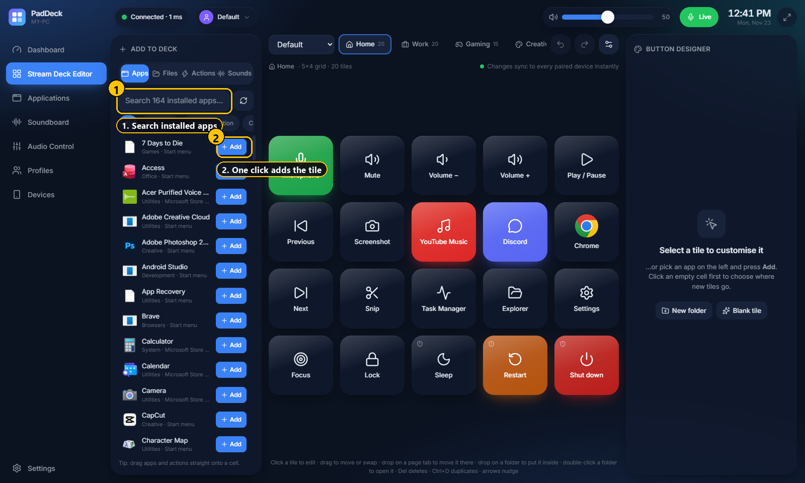

**STEP 1 – Open:** PadDeck on the PC → **Stream Deck Editor**.
**STEP 2 – Click:** (optional) click an empty dashed square to choose where the tile goes. In the **Add to deck** panel, make sure the **Apps** tab is selected.
**STEP 3 – Select:** type the app's name in **Search installed apps…** and click **Add** next to it. (Or drag the app onto a square.)
**STEP 4 – What happens:** a new tile appears with the app's real icon and name. A message says *Added "…"*.
**STEP 5 – Confirm:** look at your tablet – the same tile appears instantly. Tap it and the app opens on your PC.

You can also use the **Applications** page: choose the page in **Add to**, then click **Add** on any app.

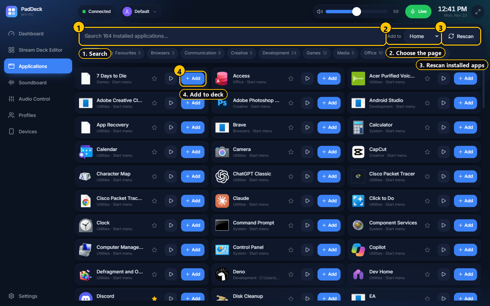

### From the tablet
**STEP 1:** tap **Edit** (top right). Tiles start to wiggle.
**STEP 2:** tap an empty **dashed square** (+).
**STEP 3:** in *Add a tile*, choose **Apps**, search, tap **Add**.
**STEP 4:** the tile appears where you tapped.
**STEP 5:** tap **Done**, then tap the new tile to test it.

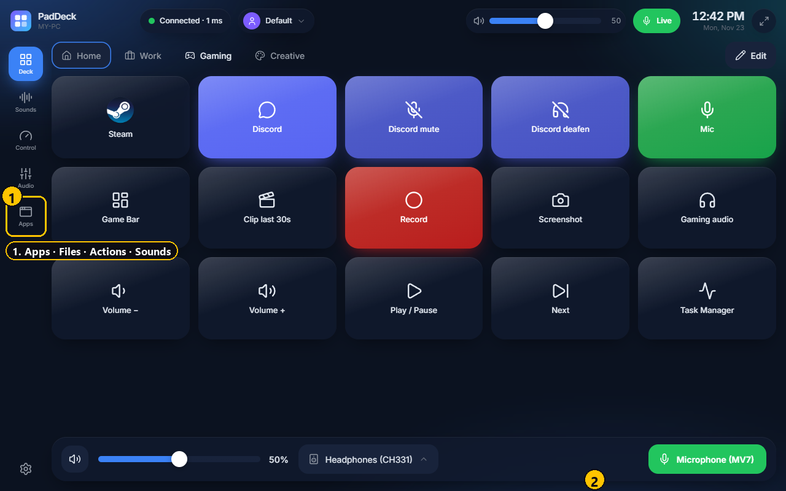

**Adding files and folders:** use the **Files** tab. On the PC, **Add a folder…** / **Add a file…** opens the normal Windows picker. On the tablet, **Browse the PC…** lets you browse your PC's folders. The tile uses the file's icon and name; if the file is later moved or deleted the tile shows **Unavailable**.

**Common mistakes:** the page is full (*"This page is full"*) – add a page or make the grid bigger (Edit → tap the page name → Grid size). App missing from the list – click **Rescan** (Applications page).

---

## 9. Removing applications
**Purpose:** delete tiles you no longer need.

**On the PC:** **STEP 1** Stream Deck Editor → **STEP 2** click the tile → **STEP 3** click **Delete** in the button designer (or press the **Delete** key) → **STEP 4** the tile disappears and a message offers **Undo** → **STEP 5** the tablet updates instantly.

**On the tablet:** **STEP 1** long-press the tile → **STEP 2** tap **Delete** → **STEP 3** the tile is removed → **STEP 4** changed your mind? Tap **Edit** → **Undo**.

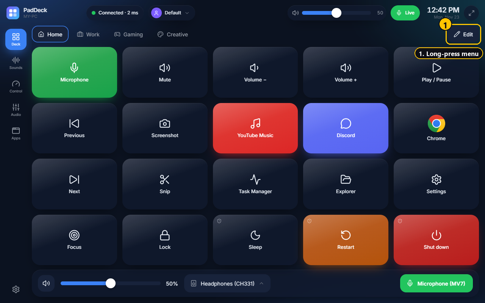

**Tip:** deleting a folder tile also deletes the tiles inside it (Undo brings them back).

---

## 10. Rearranging tiles
**Purpose:** put your most-used tiles where you want them.

**On the PC (drag and drop):**
**STEP 1:** open **Stream Deck Editor**.
**STEP 2:** press and hold the mouse on a tile.
**STEP 3:** drag it onto another square. Drop on an empty square to move it; drop on another tile to **swap** them; drop on a **page name** to move it to that page; drop on a **folder** tile to put it inside.
**STEP 4:** the grid updates immediately.
**STEP 5:** the tablet shows the new order.

**Without dragging:** select a tile and use the **arrow buttons** in the designer (or the arrow keys), or **Move to…** to send it to another page.

**On the tablet:** tap **Edit**, drag a tile to a new square, tap **Done**. Or long-press a tile → **Move to page…**. In portrait/phone layouts, long-press → **Move earlier / Move later**.

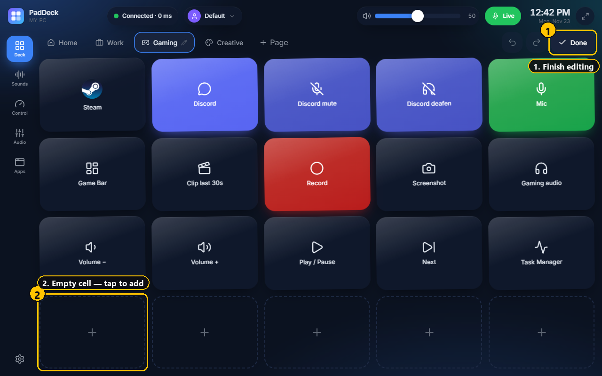

**Creating a folder:** Editor → **Add to deck → Actions → Folder** (or **New folder** when no tile is selected). Then drag tiles onto it. Double-click a folder in the editor (or tap it on the tablet) to open it.

---

## 11. Customizing buttons
**Purpose:** change what a tile does and how it looks.

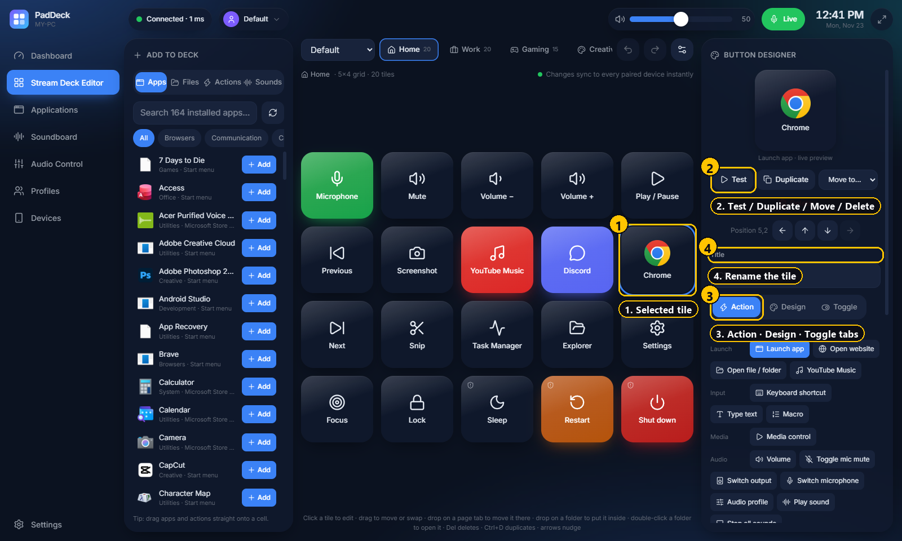

**STEP 1 – Open:** Stream Deck Editor (PC), or **Edit** → tap a tile (tablet).
**STEP 2 – Click:** the tile you want to change. The **Button designer** shows a live preview.
**STEP 3 – Select:**
- **Title** – type a new name.
- **Action** tab – choose what it does: *Launch app, Open website, Open file/folder, YouTube Music, Keyboard shortcut, Type text, Macro, Media control, Volume, Toggle mic mute, Switch output, Switch microphone, Audio profile, Play sound, Stop all sounds, System, Run approved script, Focus mode, Discord, Go to page, Open folder, Switch profile, Switch mode.* Tick **Ask before running** to add a confirmation.
- **Design** tab – icon (search 2,000+ icons), emoji, **Upload image**, **App icon/File icon**, icon position (Top/Left/Right/Icon only), background colour, **Gradient to** + angle, text colour, font size, corner radius, width/height (1–3 squares), **Hide title**.
- **Toggle** tab – give the tile an on/off look: active title, icon and colours, following *mic muted*, *speakers muted*, *music playing*, *Focus mode*, or each press.
**STEP 4 – What happens:** the preview and the tile update immediately (on the tablet, press **Save**).
**STEP 5 – Confirm:** click **Test** (PC) to run the action, or tap the tile on the tablet.

**Changing the whole look:** Settings → **Appearance** → choose Dark, Light, Midnight, AMOLED, Minimal or Custom, and edit any colour with the picker or a HEX code like `#01B6BE`. Save favourites under **Saved themes**.

**Common mistakes:** a size that doesn't fit – move the tile first, then make it bigger.

---

## 12. Creating and managing profiles
**Purpose:** keep separate layouts for different activities (e.g. Work and Gaming).

**STEP 1 – Open:** PC → **Profiles** (tablet: Settings → Profiles).
**STEP 2 – Click:** **New (copy of current)** to create one, the ✏️ to rename/recolour, the copy icon to duplicate, or the bin to delete.
**STEP 3 – Select:** **Use** to make a profile active.
**STEP 4 – What happens:** pages, tiles, soundboard and theme switch to that profile.
**STEP 5 – Confirm:** the profile name appears next to the connection badge.

**Quick switch:** tap the profile name in the top bar of the tablet. Each device can use its own profile: tablet → Settings → **This device** → *Profile on this device*.

---

## 13. Using microphone controls
**Purpose:** mute or unmute your microphone instantly (works in every app – Zoom, Teams, Discord, games).

**STEP 1:** find the **Microphone** tile (Home page) or the microphone button at the bottom right / **Live** button at the top.
**STEP 2:** tap it.
**STEP 3:** nothing to select.
**STEP 4:** the tile turns **red** and reads **Mic muted**; the top button reads **Muted**. A message *Microphone muted* may appear.
**STEP 5:** tap again – it turns **green** (*Live*).

**Switch microphone:** open **Audio** → tap a microphone in the *Microphone* list. Drag the slider to change its volume.

**Discord's own mute/deafen:** set keybinds in Discord (User Settings → Keybinds) and the same keys in PadDeck → Settings → **Integrations**, then use the **Discord mute** / **Discord deafen** tiles (Gaming page).

**Common mistakes:** muting a microphone that isn't the default one – check **Audio**.

---

## 14. Using volume controls
**Purpose:** change your PC volume without touching the PC.

- **Volume + / Volume −** tiles change the volume by 5%.
- **Mute** tile mutes the speakers (turns red while muted).
- The **slider** at the bottom sets an exact level; the percentage shows next to it.
- **Audio** section: switch between headphones and speakers with one tap, and set **per-app volume** (e.g. make Chrome quieter) under *App volume*.

**STEP 1** tap **Volume +** → **STEP 4** the slider moves up and the percentage increases → **STEP 5** you hear it louder.

**Audio profiles** (Audio section) change several settings at once, e.g. *Meeting* sets the volume and unmutes the mic.

---

## 15. Using media controls
**Purpose:** control music and videos.

**Prerequisites:** something playing or paused in a browser (YouTube Music, YouTube), Spotify or a media player.

- **Play / Pause** – starts or pauses playback (its icon changes to Pause while music plays).
- **Next / Previous** – skips tracks.
- **Control Centre → YouTube Music** shows the song title, artist, artwork and progress; drag the bar to **seek**.

**Common mistakes:** nothing playing – start the music once on the PC first.

---

## 16. Taking screenshots
**Purpose:** capture your PC screen from the tablet.

**STEP 1:** tap **Screenshot** (Home page).
**STEP 4:** PadDeck saves a picture of **all** your screens and shows *Saved PadDeck_2026-…png (also on clipboard)*.
**STEP 5:** open **Pictures → Screenshots** on the PC, or paste (**Ctrl+V**) into a chat or document.

**Snip** opens the Windows snipping tool (**Win + Shift + S**) so you can drag over an area.

---

## 17. Launching applications
**Purpose:** open your favourite apps in one tap.

The Home page includes **YouTube Music**, **Discord** and **Chrome**; **Explorer**, **Task Manager** and **Settings** open those Windows tools. Tap a tile – a message such as *Discord launched* confirms it. Add more apps in [section 8](#8-adding-applications). The **Apps** section on the tablet also lists every installed app – tap ▶ to launch it.

**Tip:** If an app was uninstalled, its tile shows an error message when tapped – edit or delete the tile.

---

## 18. Using Windows shortcuts
**Purpose:** press keyboard shortcuts from the tablet.

The **Work** page has ready-made shortcuts: Copy (Ctrl+C), Paste (Ctrl+V), Undo (Ctrl+Z), Redo, Save, Alt+Tab, Task view, Show desktop (Win+D), Snap left/right, Emoji, Clipboard history.

**Make your own:** add a tile → **Actions → Custom shortcut** → in the designer's *Key combination* type e.g. `Ctrl + Shift + S` (or tap **+ ctrl**, **+ shift** …). **Macro** runs several steps in a row (keys, text, delays). **Type text** types a phrase for you.

**Common mistake:** shortcuts don't reach programs running as administrator.

---

## 19. Using power controls
**Purpose:** lock, sleep, restart or shut down the PC.

> ⚠️ **Save your work before using Restart, Shut down or Sleep.**

| Tile | What happens |
|---|---|
| **Lock** | Locks Windows immediately (like Win + L). No confirmation. |
| **Sleep** | Asks *"Sleep?"* – tap **Confirm** and the PC goes to sleep. |
| **Restart** | Asks for confirmation, then restarts after **5 seconds**. |
| **Shut down** | Asks for confirmation, then shuts down after **5 seconds**. |

Tiles with a small shield symbol ask for confirmation. To stop a restart/shutdown in those 5 seconds, add a **System → Cancel shutdown** tile.

---

## 20. Using the soundboard
**Purpose:** play sound effects through your PC speakers (great for streams and calls).

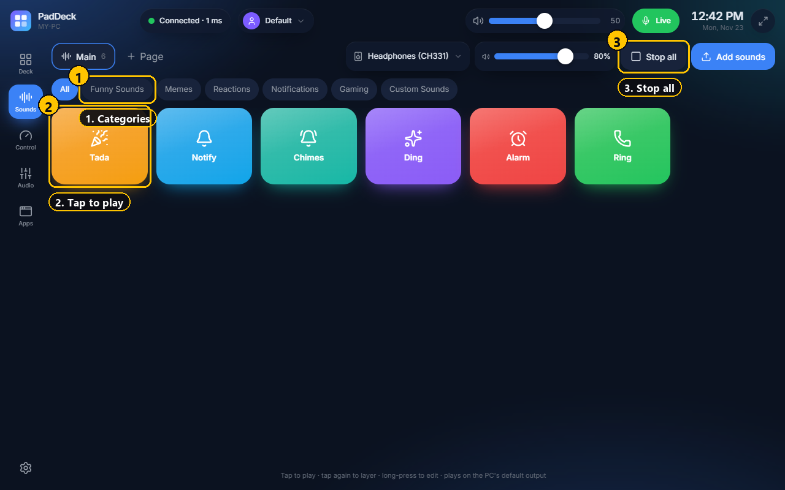

**STEP 1 – Open:** **Sounds** (tablet) or **Soundboard** (PC).
**STEP 2 – Navigate:** tap a **category** (All, Funny Sounds, Memes, Reactions, Notifications, Gaming, Custom Sounds) or a **page** (Main, + Page).
**STEP 3 – Play:** tap a sound. Tap again to play it on top of itself; play several at once.
**STEP 4 – Stop:** a playing sound shows ■ (stop) and ↺ (replay) buttons; **Stop all** silences everything.
**STEP 5 – Confirm:** you hear it from the PC's speakers or headphones (shown at the top – tap to change).

**Add sounds:** **Add sounds** → choose MP3, WAV, OGG, M4A or FLAC files (on the PC you can also drag files onto the soundboard).
**Manage a sound:** long-press it → change name, icon or emoji, colour, category, page or volume; **Preview on PC**; **Delete**.
**Master volume:** the slider next to *Stop all*.

**Common mistakes:** Focus mode on (it mutes the soundboard); wrong output device selected.

---

## 21. Using the Control Centre
**Purpose:** see your PC's health and quick controls at a glance.

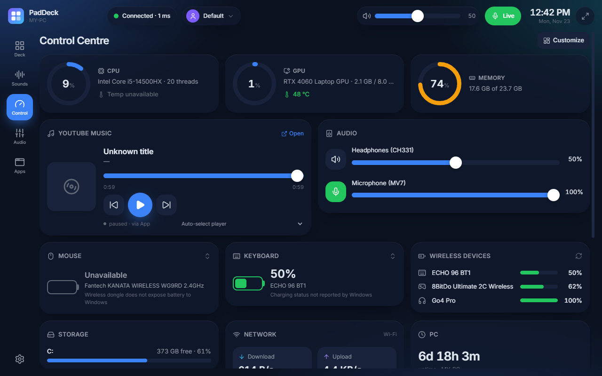

Open **Control** (tablet) or **Dashboard** (PC). Widgets:
- **CPU, GPU, Memory** – usage rings; GPU temperature on NVIDIA cards; CPU temperature needs LibreHardwareMonitor.
- **YouTube Music** – current song, artwork, progress bar, play/pause, next/previous, volume.
- **Audio** – speaker and microphone sliders.
- **Mouse / Keyboard** – name and battery for Bluetooth devices (tap ⇅ to pick which device). USB-dongle devices show *Unavailable*.
- **Wireless devices** – batteries of other Bluetooth devices (headsets, controllers).
- **Storage, Network, PC uptime**, **Discord & voice**, **Shortcuts**, **Focus mode**.

Tap **Customize** to show, hide or reorder widgets. PadDeck never invents numbers – missing readings show *Unavailable*.

---

## 22. Disconnecting and reconnecting
**Purpose:** take a break or move the tablet without losing your setup.

- **Disconnect:** close the PadDeck app, lock the tablet or turn off Wi-Fi. The PC shows a notification *Tablet disconnected* after a few seconds.
- **Reconnect:** open the app again on the same Wi-Fi – it reconnects automatically (the badge goes *Connecting… → Connected*).
- **Remove a device for good:** PC → **Devices** → **Remove**. To use it again, pair with a new code.
- **Unpair from the tablet:** Settings → **This device** → **Unpair this tablet**.
- **Stop anyone new from pairing:** PC → Devices → switch off **Allow new tablets to pair**.

---

## 23. Troubleshooting
Quick fixes for the most common issues – full list in [TROUBLESHOOTING.md](TROUBLESHOOTING.md).

| Problem | Quick fix |
|---|---|
| Can't connect | Same Wi-Fi? PadDeck running on the PC? Devices → **Allow through firewall**. |
| Code rejected | Press **New code** – codes expire after 5 minutes and work once. |
| Button does nothing | Check the badge says **Connected**; read the message at the bottom of the screen. |
| App won't open | Applications → **Rescan**, then edit the tile. |
| Mic doesn't mute | Make the right microphone the default in **Audio**. |
| No sound from soundboard | Check the output device at the top of the Soundboard; turn off Focus. |
